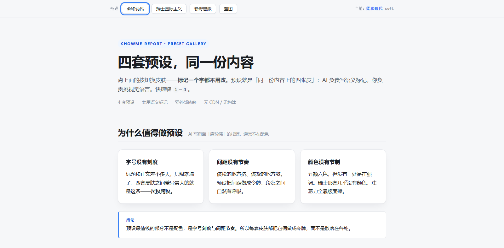
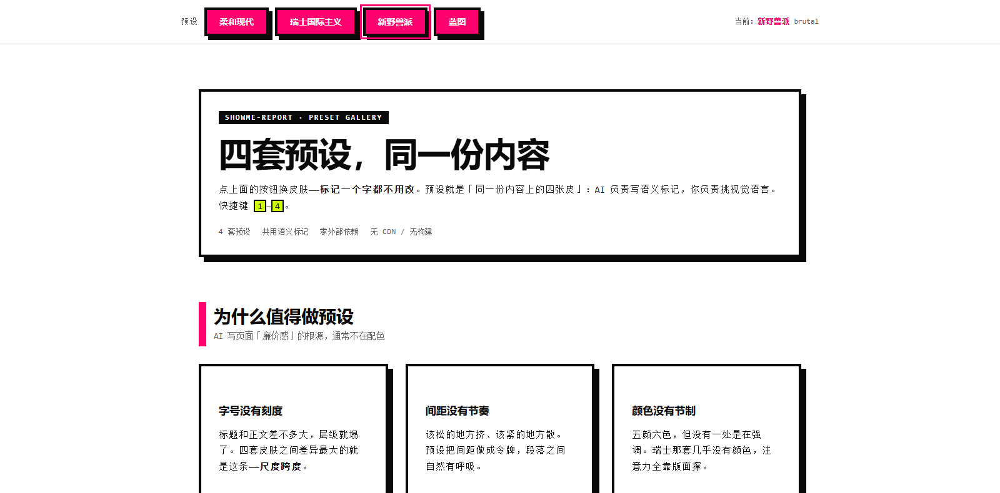
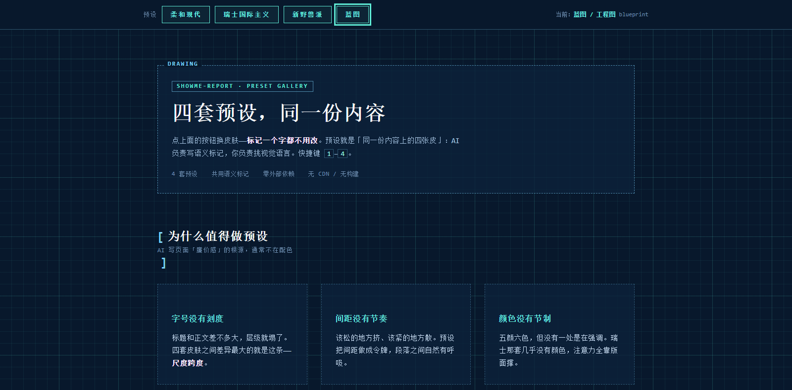
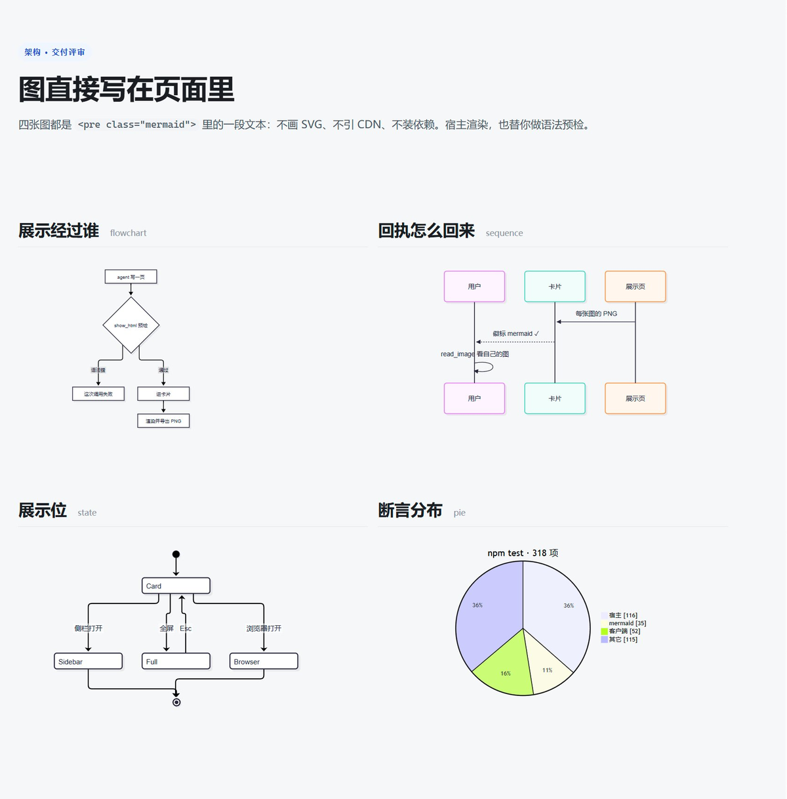
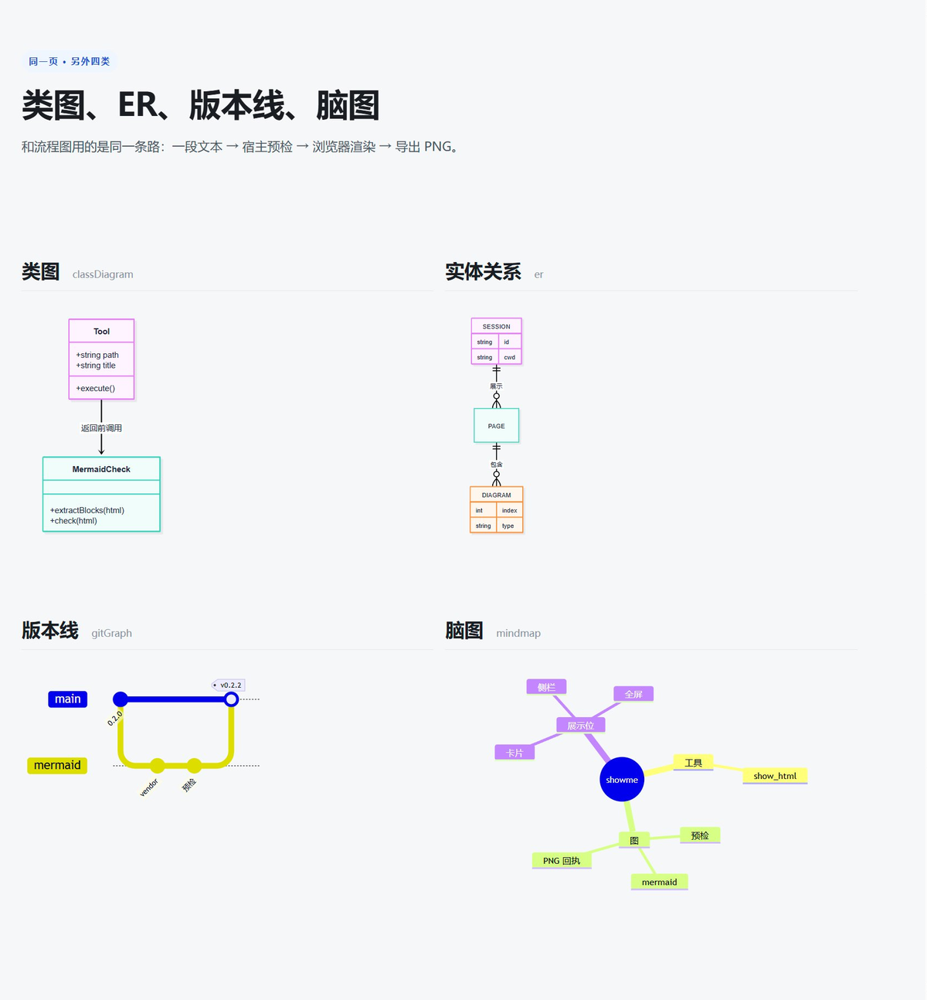
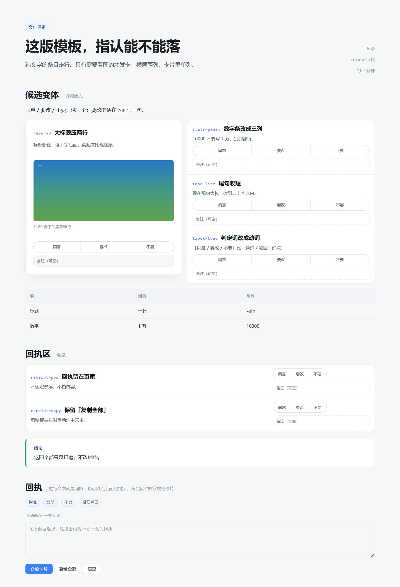

# dsh-showme-html · 把成果摊开给你看

> **English**: A DeepSeek Harness plugin that renders a workspace HTML page inside the conversation as a card, and hands the user's per-item verdicts back to the agent as one line per item.


[](LICENSE)


> 让 agent 把成果摊开给你看，让你点着回话。

DSH（DeepSeek Harness）插件。给 agent 一个快捷入口：把工作区里写好的 HTML 页直接展示在对话里；
并让用户在页面上"点名 + 表态"产生的文本，**一行一条**地回到 agent 手里。

仓库：<https://github.com/liceses/dsh-showme-html>


*图 · 一次真实交付（示例页 `examples/promo.html`）—— 一屏里三件事都拍到了：**卡片头部**是 `show_html` 徽章、标题、体积，以及 侧栏打开 / 刷新 / 全屏 / 浏览器打开；**页面本体**是瑞士国际主义皮肤，顶部那排还能现场换皮肤（换的只是那一个 `<link>`）；**底部反馈条**里的 `pain-markdown 补充` 就是用户在页面上点选之后，由**页面替他组织好**的一行回执 —— 接着按「填入输入框」，这句话就追加进了对话输入框。*

---

## 快速开始

### 一、装

```powershell
# 从 GitHub 直接装
dsh plugin --profile web add "github:liceses/dsh-showme-html"

# 或者从本地源码目录装（开发时用，改完源码好追踪）
dsh plugin --profile web add "link:<本目录绝对路径>"

# 两种方式都需要重启 dsh web 才生效（宿主半区在启动时装载）
```

配套的 `showme-report` skill 用一个目录联接挂进去，**热发现、不用重启**：

```powershell
New-Item -ItemType Junction -Path "$env:USERPROFILE\.dsh\skills\showme-report" `
         -Target "<本目录绝对路径>\skill\showme-report"
```

> **这个联接是可选的。** 插件在启动时会检查它：**在，就什么都不做**（让文件系统 provider
> 继续提供"改完 SKILL.md 立刻生效"的热发现）；**不在，就用 `ctx.skills.register()`
> 运行时注册兜底**，保证装了这个插件就有这个 skill。
>
> 之所以做这层兜底：联接在仓库之外，任何一次清理都可能把它悄悄弄丢，
> 而症状只是"模型不再加载 skill"，从外面完全看不出来。想知道它还在不在：

```powershell
npm run doctor          # 一体检：资产 / skill 投递 / profile 装配 / 运行中的路由 / 客户端半区 / 落地副本
```

> 没有构建步骤：`lib/` 就是成品，仓库里没有"编译产物"这一层。

> **支持的 DSH 版本**：`engines.dsh` 声明为 `^0.1.7-rc.1 || ^0.2.1-rc.1`，
> 实测通过 `0.1.7-rc.2`、`0.2.1-rc.2` 与 `0.2.1-rc.5`（宿主 + 浏览器两个半区都验过，
> 见下面的「开发」一节）。
> 这条声明是**硬门禁**：DSH 在安装和启动时会拿它跟自己的运行时版本比对，不匹配就拒绝装载
> （`Plugin dsh-showme-html@<ver> is incompatible with dsh <ver>: requirements {"engines.dsh":"..."}`）。
> 确实要在未声明的版本上试，用精确版本豁免放行：
>
> ```powershell
> dsh plugin --profile web allow-version dsh-showme-html@<包版本> --dsh-version <DSH 版本> --accept-risk
> ```
>
> 豁免只对**那一个** `包@版本 × DSH 版本` 生效，写进 profile 的 `compatibility.json`；
> 升级 DSH 或改包版本号后要重新放行 —— 它是逃生舱，不是兼容承诺。

> **从 0.2.1 及更早升上来，只需要重启一次**（0.2.3 与 0.2.2 功能完全一致，只补了文档与截图）。
> mermaid 的 5.5 MB 随包走（`vendor/`），不下载、不改配置；落地副本那边 `presets/` 不用动，
> `templates/README.md` 想拿到新版就跑 `npm run assets:refresh`
> （create-only，旧文件会先备份成 `.bak-<时间戳>`）。
> 重启后确认新建的实例认得新路由：
>
> ```powershell
> node test/doctor.mjs      # [4] 里应有「vendor 路由可达 …… 与磁盘一致（5494801 字节）」
> ```

### 二、用：一次完整的使用长这样

```
1. agent 写完东西，按共用语义标记写一页 HTML，挑一套皮肤：

     <link rel="stylesheet" href="presets/swiss.css">

2. 调一次工具：

     show_html({ path: ".dsh/showme/review.html",
                 title: "设计评审",
                 note: "挑一个变体" })

3. 卡片直接出现在对话里 —— 不用去文件树里翻、不用切浏览器。
   卡片头部：侧栏打开 / 刷新 / 全屏 / 在浏览器打开原文件。

4. 你在页面上点选、写备注；页面实时把它组织成一行一条的文本。

5. 点「填入输入框」—— 追加到你已有的内容后面。或者直接选中复制。
```

**不新增任何常驻服务**：宿主就是 DSH 已经在跑的那个 web server；反馈在浏览器内完成。
页面默认落在 `.dsh/showme/`（隐藏目录，不污染源码树、不进 git）。

---

## 目录

| 想了解 | 看这里 |
| --- | --- |
| 为什么需要它 | [它解决什么](#why) |
| 它有哪些能力 | [核心能力](#features) |
| 四套皮肤长什么样 | [四套预设样式](#presets) |
| 流程图 / 时序图怎么写 | [页面里画图：mermaid](#mermaid) |
| 想少写点代码 | [模板：三份骨架](#templates) |
| 那个 skill 和插件什么关系 | [`showme-report` 与 DSH 的关系](#skill) |
| 它到底怎么实现的 | [工作原理](#how) |
| 页面里的脚本能干什么 | [安全模型](#security) |
| 卡片为什么不会被折叠 | [卡片在哪一行](#chat-row) |
| 自动开右栏 / 计划页怎么设 | [设置](#settings) · [计划页](#plan-page) |
| 刷新会不会丢我填的东西 | [刷新 / 切会话不丢](#draft) |
| 有什么坑 | [已知限制](#limits) |
| 想改代码 | [仓库结构](#layout) · [开发](#dev) |
| 许可 | [许可](#license) |

---

<a id="why"></a>
## 它解决什么

### 一、读完一屏 Markdown，你还是"没看见"

agent 干完一件大事，甩给你 200 行 Markdown。你读完了，但你没有**看见**那个东西。

十几个变体的像素级差异、时间线、两种方案并排、改前改后对比——这些本质上是**空间与视觉**的信息。
压成文字就是降维，你只能在自己脑子里把它重新拼回一张图。

> 判断标准很简单：**这件事你是"读"更省事，还是"看"更省事。**
> 前者继续用 Markdown；后者交给这一页。

### 二、AI 产出了十几个变体，而你叫不出它们的名字

这是最初做出这个插件的动机，原话是：

> "我有很多 AI 生成的图片或者网页组件，我没办法一个一个准确地叫出它们的名字，
> 他们的名字是 AI 可以给出的。我希望我选择哪一个，就可以得到它的名称用来和 AI 交流，
> 还能表达我的意见，比如说同意，或者要某个组件的风格。"

于是对话常常变成——"把第三个、就是那个带渐变的那张再改一下"。而你嘴里的"第三个"，
和 agent 理解的"第三个"是不是同一个东西，全凭运气。

**这个插件给每样东西一个稳定、唯一、页面上看得见的名字**（`hero-banner-v3`、`f2`、`shot-07`）。
指认从此没有歧义。

### 三、反馈回去的路上，意思总会走样

读页面 → 组织语言 → 打字 → agent 猜你指的是哪一项。这条路上每一步都在丢信息。

这里把它压成 **点两下 → 页面替你写好一句话 → 粘回去**：

```
同意 hero-banner-v3（第 3 版），按它的风格继续；不要 stats-panel-v1（颜色太灰）。
```

这句话放进一个能鼠标选中、能 Ctrl+C 的 textarea 里——**这是唯一永远可用的回传方式**。
页面还会顺手把它 `postMessage` 给卡片，于是你能一键**追加**进输入框（不覆盖你已经写了一半的草稿）。

### 四、AI 写出来的页面有"廉价感"

标题和正文一样大、行高挤成一团、颜色随机、还得连 CDN 才敢用。

插件附了**四套预设样式**，每套都把**字号刻度与间距节奏**做成设计令牌——
那才是"好看"的真正来源，不是配色。四套**吃同一套语义标记**，所以换皮肤一个字都不用改标记。

---

<a id="features"></a>
## 核心能力

| | |
|---|---|
| **工具 `show_html`** | agent 调一下，就等于"把这一页给用户看"。参数只有 `path` / `title` / `note`；**不收 HTML 正文**——正文进参数会白烧一遍 token，而且页面会被反复改，留成文件才可迭代、可留档。 |
| **镜像读路由** | `GET /api/showme/raw/<sessionId>/<工作区相对路径>`。按工作区目录结构分发，于是页面里的**相对引用天然可用**（``、预设 CSS、下级页），**同一个地址就是「在浏览器打开原文件」**。 |
| **对话内卡片** | 标题 / 体积 / **侧栏打开** / 刷新 / 全屏 / 浏览器打开；**非可见的卡片不持有活 iframe**（历史里几十张卡片不会把会话拖卡）。卡片是一条**独立的 Chat 行**，不在「工作步骤」过程组里 —— 轮次结束、工具调用被收起时它仍然看得见（见 [卡片在哪一行](#chat-row)）。 |
| **侧栏打开** | 把这一页放进**原生右侧栏**（插件自己注册的页 tab 类型 `showme-page`，正文就是同一个镜像地址的 iframe）；右栏服务不在时兜底到新标签页并说明。**不认领任何后缀**——`.html` 的默认归宿仍然是原生 `builtin` 预览。 |
| **画面内全屏** | 走框架级浮层，Esc 退出回到原位、滚动位置不丢。**控件全在底部**：Windows 桌面端顶部 40px 是原生窗口按钮、画在网页之上，放在那里永远点不到（这条是踩过的现场）。 |
| **反馈两条路** | ① 页面 `postMessage` 给卡片 → 一键填入输入框；② 页面 `POST /api/showme/feedback` 追加到 `<工作区>/.dsh/showme/inbox.jsonl`。都不实现也不影响——页面里的可选中文本本来就是通用交换格式。 |
| **草稿不丢** | 页面里选的判定、写了一半的备注会自动存一份草稿：**刷新 iframe、切会话再回来、卡片重新挂载**都还在，顶部横幅写明「已恢复 …·清空」。见 [刷新 / 切会话不丢](#draft)。 |
| **四套预设样式** | 见下。 |
| **模板按内容定密度** | 条目不是"一人一张卡"：**纯文字排成一块面板、一行一条，只有带 `image` 的条目才单独成卡**。同屏不再是一排一模一样的卡，视觉重量只留给真需要看图的东西；横屏（≥900px）报头走两栏、文字行的判定控件靠右成一列，卡片里（≤760px）行折成一列、判定控件铺满。 |
| **mermaid 图** | 页面里写 `<pre class="mermaid">graph TD; A-->B</pre>` 就会渲染成 SVG。宿主侧有**同步语法预检**：图写错 → `show_html` 这次调用**直接失败**，报错是 mermaid 自己的 `Parse error on line N` 原文。渲染完每张图导出一张 PNG，路径随工具结果返回，agent 可以 `read_image` 看自己画的图。见 [mermaid](#mermaid)。 |
| **回执体检 + 引用体检** | `show_html` 展示前扫一遍页面：**缺可点名的 id**、**缺 `postMessage` 回传**（只给"可复制文本"不算），或**引用了不存在的相对资源**时，把提醒**随工具结果**交回给模型。实测过 skill 被加载、被读，却没被照做——工具结果是这条链路上唯一不依赖模型自觉的通道。 |
| **skill `showme-report`** | 教 agent 怎么写这一页：挑皮肤、回执契约、交换格式、沙箱坑。**不含版式要求**——版式仍然是 agent 的活。 |

---

<a id="presets"></a>
## 四套预设样式

放在插件包的 `styles/`，**宿主在你第一次展示页面时自动落到工作区**
`<工作区>/.dsh/showme/presets/`（**create-only**：已存在的不覆盖，所以你可以自己改）。

页面引用就是一行：`<link rel="stylesheet" href="presets/soft.css">`

| slug | 名字 | 什么时候用 |
|---|---|---|
| `soft` | 柔和现代 | **默认**。通用汇报、进展同步、长时间阅读 |
| `swiss` | 瑞士国际主义 | 编辑部长文、结论多的分析、要权威感 |
| `brutal` | 新野兽派 | 设计评审、多变体挑选、强指认感 |
| `blueprint` | 蓝图 / 工程图 | 架构、数据流、时序、依赖关系 |


*图 · 真实示例页 `examples/preset-gallery.html`（本地渲染，柔和现代 = 默认皮肤）—— 顶部那排就是换肤开关，页面上半部分是内容。*

同一份标记，只换那个 `<link>` 指向的文件：


*图 · 同一页、同一份标记，皮肤换成 `brutal`（新野兽派）—— 黑粗边框、硬阴影、无圆角、品红强调。*


*图 · 再换成 `blueprint`（蓝图 / 工程图）—— 深蓝底 + 网格、青色线条、全等宽、虚线框。标记仍然一个字没动。*

**四套吃同一套语义标记**（`.page` `.masthead` `.kicker` `.lead` `.section` `.card` `.cols`
`.stat`/`.num` `.chips`/`.chip` `.btn` `.table` `.callout` `.evidence` `.timeline` `.kv`
`.code` `.muted` `.mark` `.rule`）——**换皮肤不用改标记**。这也是「可切换预览器」能成立的前提。

- `styles/index.json` 是清单，里面那行 `default` 就是默认皮肤，**改一行即可**。
- `soft` / `swiss` 跟随系统明暗；`brutal` 固定亮色；`blueprint` 固定暗色。
- **自包含**：无 `@import`、无外链字体、无 `url()`、无 CDN。断网也完整。
- 想用 [StyleKit](https://www.stylekit.top/zh/styles) 目录里的其他风格（148 种）？
  它的 `tokens` / `components` 是 Tailwind 类名与 React JSX，**单文件静态页直接用不了**；
  把它当**约束清单**（`colors` / `doList` / `dontList` / `philosophy`）自己翻译成原生 CSS。
  具体路径写在 `skill/showme-report/SKILL.md` §2.4。
- **预设不是强制的**：要评审/复刻某个具体系统的视觉时（比如评审 DSH 插件自己的设置页），
  用那个系统的官方调色板才对——这时**不要写 `<link>`**，否则两套视觉会叠在一起。
  理由写在 skill §2.3。

---

<a id="mermaid"></a>
## 页面里画图：mermaid

流程图、时序图、状态机、类图、ER 图、饼图、甘特图、思维导图——**直接写在页面里**，
不画 SVG、不引 CDN：

```html
<pre class="mermaid">
graph TD;
  A[调用 show_html] --> B{宿主预检};
  B -->|通过| C[渲染成图];
  B -->|语法错| D[这次调用失败];
</pre>
```

四种写法等价：`<pre class="mermaid">`、`<div class="mermaid">`、
`<code class="language-mermaid">`、`<pre data-mermaid>`。


*图 · 真实展示页 `examples/mermaid-demo.html`（柔和现代皮肤，经镜像路由在浏览器里打开）—— 四张图在页面源码里各自只是一段文本：`flowchart` / `sequence` / `state` / `pie`，颜色和字体全由 mermaid 自己画，预设 CSS 一个字都没为它们写。*


*图 · `examples/mermaid-types.html` —— `classDiagram` / `er` / `gitGraph` / `mindmap` 走的是同一条路。图宽自适应容器，所以同一页在卡片（窄）和浏览器（宽）里都能读。*

**三件事值得说清楚：**

1. **写错就不通过。** 宿主在 `show_html` 返回**之前**把每个块解析一遍；语法错 → 这次工具调用
   直接失败，报错是 mermaid 自己的原文（`Parse error on line 2: … --------------^ Expecting …`）。
   *这是刻意的*：页面是"交付"，带着坏图的交付不算交付。所以也**没有**单独的检查工具可调——
   检查是展示的一部分。
2. **agent 能看见自己画的图。** 每张图渲染完导出 PNG，落在
   `<工作区>/.dsh/showme/mermaid/<页面名>.<序号>.png`（从 1 开始），
   路径随 `show_html` 的结果返回；同一目录还有 `<页面名>.json`（每张图的类型与尺寸）。
   渲染失败则额外写 `<页面名>.errors.txt`，卡片头部徽标变红（`mermaid 失败 ×N`）。
3. **预检只查语法。** 语法通过但运行时失败（不支持的语法糖、超时）拦不住已经返回的调用，
   由上面的红框 / 徽标 / `errors.txt` 兜。另外，预检扫的是**页面文件里静态写着的**块——
   JS 里拼出来的块不会被预检（浏览器里照样渲染）。

**为什么是 vendored 的 5.49 MB 单文件，而不是 CDN：**

| 选择 | 原因 |
|---|---|
| 单文件普通脚本 | 页面跑在 `sandbox` 的**不透明源** iframe 里，`fetch` 同源资源会被当跨域拦住，只有 `<script src>` 过得去；ESM 版会拆成 208 个 chunk（24 MB），一个 `<script src>` 引不动。 |
| 由插件自己发 | `GET /api/showme/vendor/mermaid.min.js`，白名单里就这一个文件。不连外网、不看 CDN 脸色，断网也完整。 |
| 版本钉死 | mermaid **12.2.0**，sha256 `a8a6a6f8…`；`npm run vendor:mermaid` 可重新拉取。 |

**Node 侧为什么能跑：** 预检把同一个 bundle 喂进 `node:vm`。没有真 DOM 时 dompurify 会退化成空壳，
流程图一解析就抛 `TypeError: Z1.addHook is not a function`——所以在**内存里**把
`Z1=Rsr()` 换成一个 stub（磁盘上的文件不动，浏览器拿到的仍是原版）。首次加载 ~150 ms（每进程一次），
每块 5–50 ms。补丁点由测试钉住：升级 mermaid 时先红，再决定怎么改。

**为什么不用 `@mermaid-js/parser`：** 试过（2.0.1），它只覆盖 architecture / gitgraph / packet /
pie / radar / treemap / wardley / cynefin / info / railroad / treeview / eventmodeling ——
**没有 flowchart / sequence / class / state / er**，而这几个恰好是最常写的。

> 模板（`review` / `pick` / `report`）里**没有图块**：数据里的 `text` 是转义文本，图进不去；
> 而由 `core.js` 在浏览器里拼出来的块，宿主预检看不到。要图就自己写这一页
> （`templates/README.md` 有可直接抄的最小例子）。

---

<a id="templates"></a>
## 模板：三份骨架

skill 用文字规定"回执怎么做"，模型每次都重新实现一遍，于是**控件位置、组句、通道时机反复出错**。
模板把"实现"变成"填数据"。

文本字段只认四种行内写法（`**粗**`、`` `代码` ``、`[文字](https://…)`、换行）；表格、列表、引用、标题、围栏代码**必须用块类型**——数据里写成 markdown 的话，`show_html` 会当场失败并告诉你该用哪个块，而不是把星号和竖线原样显示给用户。要原样展示一段 markdown 时，给那个 `text` 块加 `plain: true`。

宿主在你第一次展示页面时把骨架落到 `.dsh/showme/templates/`（create-only）：

| 骨架 | 形状 | 什么时候用 |
|---|---|---|
| `review.html` | 逐项表态 | 纯文字的条目排成一行一条，带图的单独成卡；每条一个判定 + 备注。**最常用** |
| `doc.html` | 纯文档 | 没有判定控件、没有回执——长说明、机制讲解用它，别硬塞 `review`。只有一个「复制全文」。 |
| `pick.html` | 候选挑选 | 单选 / 多选。封面选哪张、这几张素材留哪几个 |
| `report.html` | 图文汇报 | 有图 / 表 / 时间线、不需要逐项表态；每小节一个轻回执 |


*图 · 渲染出来的一页 review（柔和现代皮肤）：上面那条带图的成卡、下面纯文字的排成一块面板一行一条；每条右侧就是它的 `同意 / 要改 / 不要`，备注是可选的虚线框。横屏两列、卡片里单列。*

**一页 = 外壳 + 内核 + 数据**，你只写最后那个：

```
templates/<shape>.html   外壳（**直接 write，别 cp** —— 见下）
templates/core.js        内核：渲染与交互全在这里，三个形状共用一份，别读、别改
<名字>.html              你写的页面
<名字>.data.js           ← 你唯一要写的，内容就是 window.SHOWME = { … }
```

> ⚠️ **`templates/` 在新工作区里还不存在。** 宿主是在**第一次 `show_html`** 时才创建它的，
> 而 agent 需要外壳的动作排在流程**开头**——所以第一步 `cp` 必然失败。
> 落点已改成：**先落地、后校验**，直接 `write` 这个外壳就行：

```html
<!doctype html><html lang="zh-CN"><head><meta charset="utf-8">
<meta name="viewport" content="width=device-width,initial-scale=1"><title>—</title>
<link id="skin" rel="stylesheet" href="presets/soft.css"></head><body>
<div class="page"><div id="sm-masthead"></div><div id="sm-content"></div><div id="sm-receipt"></div></div>
<script>window.SHOWME_SHAPE = 'review'</script>
<script src="templates/core.js"></script></body></html>
```

`'review'` 换成 `'pick'` / `'report'` 就是另外两个形状。你引用的 `core.js` 与 `presets/*.css`
会在展示那一刻已经就位，浏览器取它们时一定存在。

**想先把资产催出来**（例如要读 `templates/README.md`）：**随便调一次 `show_html`**，
哪怕路径不存在——落地排在**校验之前**，失败也会跑。

**文件名必须同名**：`mypage.html` ↔ `mypage.data.js`（内核按页面文件名推导）。

> 📖 **数据字段表在 [`templates/README.md`](templates/README.md)**——三个形状、全部字段、
> 10 种内容块、常见错误，4KB 一份。它也会落到 `.dsh/showme/templates/README.md`。
>
> **不要读 `core.js`**：那是实现（20KB），字段表那一份就够了。
> 实测过：一个会话为了搞清"它认哪些块类型"，把内核通读了一遍（≈5–6 千 token），
> 而答案就是那张 10 行的块类型表。`test/templates.test.mjs` 里有**一条专门盯着
> 这份文档与内核一致性的测试**——内核加了块类型而 README 没跟上，测试会红。

- **为什么最省**：只写数据（几百 token）。老写法每次从头写一个 10KB 页面 ≈ 3–4 千 token，
  而且每次都可能把回执写错。
- **为什么数据走 `<script src>` 而不是 `fetch`**：展示页在 sandbox 的不透明源里，
  `fetch` 同源资源会被当成跨域请求拦掉（我们不发 CORS 头）。经典 script 不受这条限制。
- **内核只写一份**：三个形状共用 `core.js`。这一路我已经被"抄来抄去抄出 bug"咬过一次
  （照抄 `dsh-text-drop` 的 `props.input`，而那个属性根本不存在），不想再来第二次。
- **模板是可选骨架，不是形式强制**：架构图、时序图、长文分析不是"条目式"的形状，
  那就自己写——§3 的回执契约、§4 的通道、§5 的沙箱约束照样适用。

`examples/` 里的 `template-demo.html` 是一个真实用例：外壳 **567 字节**（就是上面那段），内容全在数据文件里。

---

<a id="skill"></a>
## `showme-report` 与 DSH 的关系

这个仓库里有两样东西，**它们是同一件事的两半**：

| | 是什么 | 住在哪 |
|---|---|---|
| 插件本体 | 工具 `show_html` + 镜像读路由 + 对话内卡片 + 四套预设 + 三份模板 | `lib/` `styles/` `templates/` |
| skill `showme-report` | **教 agent 怎么写这一页**：功能契约、回执交换格式、沙箱坑 | `skill/showme-report/SKILL.md` |

**DSH 的 skill 是"按需加载的说明书"**：平时不进上下文，模型判断该用时才读进来。
所以这个 skill 不在 `lib/` 里，也不该在——它是给模型看的，不是给运行时跑的。

投递走两条路，**刻意不同时提供同名 skill**：

| 情况 | 插件做什么 | 结果 |
|---|---|---|
| `$DSH_HOME/skills/showme-report/SKILL.md` **存在**（你挂了目录联接） | 什么都不做 | `skipped-linked` —— 保留文件系统 provider 的"改完 SKILL.md 立刻生效"热发现 |
| 上面那个**不在** | `ctx.skills.register({ name, description, whenToUse, source: 'runtime', content, resourceBase })` | `registered` —— 保证"装了这个插件就有这个 skill" |
| 拿不到 `skills` 服务，或缺 frontmatter | 记一笔，不拖垮插件本体 | `unavailable` |

**skill 是索引，不是手册**（0.3.1 起）：`SKILL.md` 只留"不钉就会错"的硬契约（215 行），
字段表、版式标记、mermaid、沙箱、自检各自一份放进 `references/`，模型**按需再读**。

| 读什么 | 什么时候 |
|---|---|
| `SKILL.md` | 永远（唯一的入口） |
| `references/templates.md` | 要查字段 / 块类型 / 报错含义 |
| `references/layout.md` | 自己写页面但用预设皮肤 |
| `references/mermaid.md` | 画流程图 / 时序图 |
| `references/sandbox.md` | 页面要用存储 / 剪贴板 / 表单 |
| `references/checklist.md` | 交付前自检 |

为什么改：旧版 526 行一套读完才动手，读的是它一时用不到的版式与坑；
现在入口只有一屏多，细节在真的需要时再展开。`npm test` 里有两条守卫盯着这件事
（正文 ≤230 行、五份 references 都存在且被指到；以及"代码与文档里引用的 `skill §N` 必须真在 SKILL.md 里"）。

**兜底不是锦上添花，是必需**：联接在仓库之外，任何一次清理都可能把它悄悄弄丢，
而症状只是"模型不再加载 skill"——从外面完全看不出来。这个仓库**真的被咬过一次**。
`npm run doctor` 的第 2 段就是专门盯这一环的（它还会比对联接两侧内容是否一致）。

另外，`show_html` 的**工具描述本身**就写着"写页面之前先加载 `showme-report`"，
而**工具结果里的 `hint`** 是兜底中的兜底：页面缺回执时，提醒随工具结果直接回到模型眼前——
这条通道不依赖模型自觉去读 skill。

---

<a id="how"></a>
## 工作原理

一次 `show_html` 的时序（`lib/index.js`）：

```
① 工具被调用，拿到 path / title / note
② 先落资产：styles/* → <工作区>/.dsh/showme/presets/，templates/* → .dsh/showme/templates/
   （create-only；**排在所有校验之前**，所以"随便调一次"也能把资产催出来）
③ 再校验：扩展名必须是 .html/.htm → 路径必须在工作区内（realpath 双重校验）→ 单页 ≤ 8 MiB
④ 体检：扫页面本体 + 它引用的本地脚本 → 缺回执 / 缺 id / 引用不存在 → 拼成 hint
⑤ 返回 { path, bytes, url, hint }，url 由**宿主**算好（逐段编码，保留目录结构）
⑥ 卡片拿到 url，挂 iframe；hint 由 output.render 拼进工具结果给模型看
```

**为什么按目录结构镜像分发**：写页面的 agent 不需要知道任何 URL 前缀。
``、同目录的 `.css` / `.js`、下级 `shot-f3.html` —— 照原样写就行。
代价是多一条路由，收益是"页面可以像本地文件一样互相引用"，而且**同一个地址就是「在浏览器打开原文件」**。

**路由契约**：

| 路由 | 方法 | 说明 |
|---|---|---|
| `/api/showme/raw/<sessionId>/<工作区相对路径>` | GET | 按工作区目录结构分发；27 种扩展名的 MIME 白名单，表外 415；HTML 响应额外带 CSP `sandbox` |
| `/api/showme/feedback` | POST | 追加一行到 `<工作区>/.dsh/showme/inbox.jsonl`（上限 256 KiB） |

**反馈为什么有两条路，而且都"可以不做"**：

1. **`postMessage` → 卡片**（默认路径）：页面把汇总文本发给父页面，卡片显示它并给一个
   「填入输入框」按钮。这条最顺——它**追加**而不是覆盖你已经写了一半的草稿。
2. **`POST /api/showme/feedback` → 落盘**：页面自己直连宿主，追加进 `inbox.jsonl`，
   卡片显示"已落盘"。
3. **兜底**：页面里那段**能鼠标选中、能 Ctrl+C 的文本**。

第 3 条是"通用交换格式"：前两条都不实现，你也照样能把话带回来。
所以体检对第 1 条的判定是"缺 `postMessage` 回传就提醒"——**只给可复制文本不算**。

**资产是插件包里的原件，落地是 create-only**：`styles/index.json` 的 `default` 一行决定默认皮肤；
你在工作区里改过的副本不会被覆盖。想恢复原件，删掉工作区那份再调一次 `show_html` 即可。

---

<a id="settings"></a>
## 设置：展示页

**设置 → 展示页**（插件注册在 `settings.section` 槽里）。三个开关，存**用户级**偏好
`<DSH_HOME>/showme/prefs.json` —— 换工作区不用重设，因为这是这个人的展示习惯。

| 设置 | 默认 | 作用 |
|---|---|---|
| `show_html` 之后自动在右栏打开 | 开 | 每轮只开**最后一张**（1.2s 防抖）；每个页面只自动开一次，**你手动关掉后不再抢**；窗口窄于 1200px 时不自动开 |
| 计划页 | `offer` | `off` 只写 markdown / `offer` 复杂计划额外产一页 / `require` 一律产页（markdown 只留摘要） |
| 计划评审出现时自动打开计划页 | 开 | 只对 markdown 里写了「展示页：<路径>」的那次评审生效 |

设置页读写走 `GET|POST /api/showme/prefs`（字段白名单 + 原子写 + 30s 缓存）。

---

<a id="plan-page"></a>
## 计划页：plan 模式下产出一页

`/plan` 的计划本身仍然是 **markdown**（`exit_plan_mode` 的参数没变，评审面板渲染的仍是它的首行/首段）。
计划页是它的**展开**，不是替代 —— 这样计划依旧可 diff、可审计、被 session projection 持久化。

**怎么触发**

1. 插件在系统提示里追加一段 `showme:plan-page`（`planPage: off` 时为空串），告诉模型：
   涉及方案对比 / 多变体 / 证据 / 多步取舍时，额外用模板写一页，并在 markdown 第一段写一行
   `展示页：<工作区相对路径>`。
2. **写页面那一刻**：卡片按设置自动在右栏打开它。
3. **评审出现那一刻**：评审 action 槽里会多一个「打开展示页」按钮，并按设置自动开一次。

> ⚠️ **不要指望 markdown 里的路径变成链接**：评审面板只渲染 markdown 的首行/首段，
> 原生文档预览那条路又会把 HTML 塞进 blob iframe（丢掉文件名，模板推导数据文件直接失败）。
> 所以打开页面**只用插件自己的右栏页类型**，并且在打开前对镜像地址做一次 `HEAD` ——
> 路径不存在时给一句人话（「这个路径在工作区里不存在」），**绝不打开一个空白 tab**。

---

<a id="chat-row"></a>
## 卡片在哪一行（为什么它不会被「工作步骤」折叠吃掉）

DSH 的「工作步骤展示」有两档行为：完成的轮次会把**整个过程组**收起来（简洁 / 标准 / 详细都收，
只有「完全展开」不收）。折叠不是 CSS，而是 chat 在 `TurnGroups.rebuild()` 里按
`isAtOrOutside(node, 'process')` 切分——**只有 `groupTree` 深度 ≤ `process` 的节点才不进组**。
深度表是 `exchange:0 / input:1 / turn:2 / process:3`，而工具调用行不声明 `groupTree`，
默认就落在 `process` 上。

所以 0.2.3 及更早的卡片（挂在 `tool.call.toolview` 槽位里、长在工具行内部）在轮次结束后
会被一层层折掉：用户要展开「工作步骤」→ 再展开某一组 → 才看得到页面。

0.2.4 起改成**一条自己的 Chat 行**：

```
ctx.inject(['uiConversation'], (scope) => scope.uiConversation.events.register(showmePageDefinition))
ctx.slots.inject('conversation.chat.node', () => ctx.slots.register({ name: 'conversation.chat.node', key: 'showme-page' }, ShowmePageNode))
```

节点里 `groupTree: 'turn'`（深度 2 ≤ 3）→ 不进过程组 → **折叠与它无关**。
DSH 自己的错误行（`turn-error`）用的就是同一招。工具行留着，但只剩一行摘要
（标题 / 体积 / 「页面在下方」/ 侧栏打开 / 浏览器打开），不再内嵌 iframe。

顺序是 `过程组 → 卡片 → 后续过程组 → 回答`：卡片紧跟它对应的那次调用，
所以一轮里调两次 `show_html` 就是两张卡，各自在各自的位置。

> **旧宿主怎么办**：`uiConversation` 是可选注入。服务不在（0.1.7-rc 线、更老的 0.2.x）时
> 整段不执行，`conversationRowsEnabled` 保持 false，工具行退回 0.2.3 的内嵌整卡行为。
> 换句话说：新宿主更好用，旧宿主不变。

---

<a id="draft"></a>
## 刷新 / 切会话不丢（草稿）

页面里选了的判定、写了一半的备注，**刷新 iframe、切换会话再回来、卡片重新挂载**之后还在。

为什么不靠浏览器自己的存储：展示页是 `sandbox` **不透明源**（响应头 CSP + iframe 属性都这么要求），
`localStorage` / `sessionStorage` / `cookie` 一律抛 `SecurityError`，对宿主的 `POST` 也会被跨域拦掉。
所以走的是和 mermaid 回执同一条路：

```
页面  --postMessage-->  卡片（同源）  --POST /api/showme/draft-->  <工作区>/.dsh/showme/drafts/<sha1>.json
页面  <--postMessage--  卡片（同源）  <--GET  /api/showme/draft--
```

- 页面每次变化**延迟 400ms** 存一次，`pagehide` / 切到后台时立即补一次（不会把最后那 400ms 丢掉）。
- 页面加载完发 `dsh-showme-draft-ready`，卡片读回草稿再灌进页面；套用后顶部出现一条横幅：
  **「已恢复 10-31 23:12 的表态（3 条）· 清空」**——不静默复活旧选择，不想留就一键清掉。
- 页面被重新生成过（id 变了）时只套能对上的，横幅会写「其中 N 条这页已没有，已忽略」；
  一个都对不上就不套用、也不弹横幅。
- 顺带：页面交回的反馈现在由卡片补发一份到 `/feedback`（页面自己 POST 在卡片里必然被拦），
  所以 `inbox.jsonl` 这条通道在卡片里也真的能用了。
- 草稿只留在本机工作区，`< 30 天`、最多 `200` 份，超了自动清；单份上限 64 KiB。

**升级注意**：草稿靠宿主新增的 `/api/showme/draft` 路由，**要重启一次实例**才生效；
模板 `templates/core.js` 的落地副本是 create-only，记得 `npm run assets:refresh`。

---

<a id="security"></a>
## 安全模型（两层，刻意不同）

同一个地址，两种档位：

| | 卡片内（iframe） | 真浏览器新标签页 |
|---|---|---|
| 生效的 sandbox | iframe 属性 **∩** 响应头 CSP | 只有响应头 CSP |
| 脚本 | ✅ | ✅ |
| 表单 / 下载 / `alert` / 弹窗 | ❌ | ✅ |
| 能碰到 DSH 应用本身 | ❌（不透明源） | ❌（CSP `sandbox` 强制不透明源） |

所以卡片是**安全模式**，工具栏的「浏览器打开」是**逃生门**：功能完整，但依然读不到应用数据。

其余围栏：

- **回环围栏**：只服务 `127.0.0.1`/`::1` 且 Host 是回环的请求。
  ⚠️ **不要用 `Sec-Fetch-Site` 做判断——在这里它完全冗余，而且会咬自己两次**：
  展示页跑在 `sandbox` 的不透明源里，它加载自己的图片、嵌套页、页内 `<a href>` 跳转、
  以及自己的 `fetch`，**统统**被浏览器标成 `cross-site`，`Origin` 是字面量 `"null"`。
  真正管用的是**只收回环地址** + **Host 必须是回环** + **一个 CORS 头都不发**
  （跨站方发起了也只会拿到不透明响应，拿不走工作区文件）。
- **工作区根 + realpath 双重校验**：`..`、编码穿越（`%2f` / `%5c`）、指向工作区外的软链接，一律 403。
- **扩展名白名单**：不在表里的一律 415。
- `X-Content-Type-Options: nosniff`、`Referrer-Policy: no-referrer`、`Cache-Control: no-store`。

---

<a id="limits"></a>
## 已知限制

- **不缓存**：每次刷新都重读文件（故意的——页面会被反复改）。这条只管**文件内容**：
  页面里的选择与备注由 [草稿](#draft) 另行保存，刷新 / 切会话回来还在。
- **不做范围请求**：大视频文件会整个读进内存再发。
- **不做文件监听**：改完文件要按卡片上的「刷新」（自动刷新属于后续里程碑）。
- **页面在卡片里能力受限**：见上表；需要 `localStorage` / 表单 / 下载时请用「浏览器打开」。
- **不支持 `file://` 链接**：浏览器禁止从 http 页面跳到 `file://`，所以「在浏览器打开」走 HTTP 路由。
- 单页上限 8 MiB；反馈正文上限 256 KiB。
- **`ctx.get('sessions')` / `ctx.get('sessionQuery')` 在路由所在的插件上下文里取不到**
  （Inspect 把它们标注为 `optional`）。所以权威来源改成**工具执行时记下的「会话 → 工作区根」**，
  服务查询只作兜底；认不出来时错误信息会回报具体哪个服务缺了。
- **重写页面要记得换 `<link>`**：预设是外链的，页面本身不携带样式。
- **全屏的 Esc 只在焦点还在 DSH 页面里时有效**：展示页跑在 sandbox 的不透明源 iframe 里，
  你一旦点进页面，焦点就在子文档，按键不会冒泡回父窗口。所以退出按钮**永远**要看得见、点得到
  （这就是它现在待在底部条里的原因）。
- **Windows 桌面端顶部 40px 被原生窗口按钮占用**：那是 Electron `titleBarOverlay` 画的
  **原生**图层，画在网页之上，`z-index` 再大也盖不过去。插件自己的控件一律避开那一条。
- **别把展示页交给原生文档预览看**（卡片右下角那个路径按钮走的就是它）：
  `ui-sidebar-documentpreview` 会把 HTML 塞进一个 **blob iframe**，只把相对的
  `.js` / `.css` 打包进去。于是**相对的图片、下级页、CSS `url()`**，以及模板内核
  "按自己的文件名推导数据文件"这件事，**全部失效**（现象：报"没找到数据文件：<一串 uuid>.data.js"）。
  要看这一页请用**卡片 / 侧栏打开 / 浏览器打开**这三条路 —— 它们都走镜像路由。
  模板页若确实要在原生文档预览里也能起来，把数据改成**静态引入**
  （见 `templates/README.md` 的"宿主差异"一节）。
- **mermaid 只在卡片的原路径上渲染**：图由 `/api/showme/vendor/…` 那条路由供的脚本画出来，
  所以**原生文档预览里不渲染**（blob iframe 连不上那条路由），页面里会是一片源码。
- **mermaid 预检只查语法、只扫静态块**：运行时失败与 JS 动态拼出来的块拦不住；
  页面超过 2 MiB 时不注入引导脚本（图不渲染）。
- 模板（`review` / `pick` / `report`）**没有图块** —— 数据是转义文本。要图就自己写页面。

---

<a id="layout"></a>
## 仓库结构

```
lib/index.js          宿主半区：show_html 工具 + 镜像读路由 + 反馈落盘 + 预设落地 + vendor 路由
lib/mermaid-check.js  宿主侧 mermaid 语法预检（node:vm + dompurify 单点补丁）
lib/mermaid-boot.js   注入页面的引导脚本：加载 mermaid、逐块渲染、导出 PNG、回报执
lib/client.js         浏览器半区：对话卡片 + Chat 行定义 + 画面内全屏 + 输入框镜像（closure-factory）
styles/*.css          四套预设样式（插件资产，宿主动态落地到工作区）
styles/index.json     预设清单：一行 default 就是默认皮肤
templates/            三份骨架 + core.js（插件资产，同样动态落地）
vendor/mermaid.min.js mermaid 12.2.0 的 dist 单文件（5.49 MB，sha256 钉在 vendor/README.md）
skill/showme-report/  产品核心：SKILL.md（索引，215 行）+ references/（字段表、版式、mermaid、沙箱、自检五份，按需读）
examples/             示例页源码（页面冒烟测试的夹具；mermaid-demo / mermaid-types 是截图的原件）
test/                 离线验收：清单 / 宿主 / mermaid / 客户端 / 预设 / 模板 / 页面 七组
tools/                维护脚本：vendor:mermaid · assets:refresh · asar:list · asar:scan
docs/                 需求演进与定稿方案
```

`.dsh/` 不进仓库——那是 DSH 在本工作区里的运行痕迹（展示副本、预设与模板的落地副本、反馈信箱）。

---

<a id="dev"></a>
## 开发

```powershell
npm test                # 413 项离线断言：清单 7 / 宿主 142 / mermaid 35 / 客户端 87 / 预设 38 / 模板 67 / 页面 37
                        # （Windows 上建不出软链接时少 1 条——"软链接逃逸 403"会自动跳过，总数 412）

npm run doctor          # 装机体检：资产 / skill 投递 / profile 装配 / 运行中的路由 / **客户端半区** / 落地副本

# 装配是否真的生效 —— 对着运行中的实例打真实请求
node test/live-probe.mjs <sessionId>
# sessionId 是**会话目录名**、带 session- 前缀：
#   ~/.dsh/sessions/--<工作区路径转义>--/session-<uuid>/   ← 这一整段
# 只写裸 uuid 会得到 404 unknown session。
# 解析顺序：show_html 记下的根 → sessions.get() → sessionQuery.readSession()（读磁盘），
# 所以 dsh 重启后旧会话**通常**仍能解析。真拿不到时，404 正文会带诊断串
# （形如 `sessions.get=miss sessionQuery=no-cwd`），照着它查，别猜。
# 桌面端实例要指定端口：$env:DSH_WEB_BASE='http://127.0.0.1:2785'
```

### 核对宿主契约：`tools/`

`tools/` 是开发期的小刀，**不进 npm 包**（`files` 里没有它）：

```powershell
node tools/asar-peek.mjs list 'dsh-client-ui-sidebar-right'   # 宿主到底有没有这个包
node tools/asar-peek.mjs x .dsh/out 'dsh-client-ui-sidebar-right/lib/client.js'
node tools/asar-scan.mjs titleBarOverlay 300 2                # 只知道字符串、不知道在哪个包
npm run assets:refresh                                        # 同步工作区里的落地副本
```

详见 `tools/README.md`。这个插件的关键决定都落在宿主实现上——`sidebarRightTabs` 存不存在、
`priority` 有几个值、`titleBarOverlay` 多高、`readSession()` 返回什么形状——
而答案只在装好的 `app.asar` 里。与其猜，不如读。

**零构建、零依赖**：`lib/index.js` 与 `lib/client.js` 就是成品，`package.json` 里没有任何
`dependencies` / `devDependencies` / `peerDependencies`。

- 宿主半区**不 import 任何 `@deepseek-ai/*`**。以 `link:` 安装时插件位于工作区外，
  Node 从真实路径向上找不到 profile 的 `node_modules`，外部 import 解析不了
  （同 profile 里 `dsh-text-drop` / `dsh-workspace-tree` 的宿主半区同样只用 node 内置模块）。
  因此工具定义按 `ToolDefinition` 契约手写：`{name, description, parameters}` +
  `output: {schema, render, presentationMeta?}` + `execute`，其中 `parameters` / `output.schema`
  都是**已编译好的 JSON Schema**。代价是参数校验要自己写，`execute` 里做了。
- 浏览器半区是 closure-factory 形态（`window.__ModuleLoader__.load({id, factory})`），
  平台模块（`react` 等）由加载器的模块表提供。

### 改完什么要做什么（**实测结论，没有捷径**）

| 改了 | 生效方式 |
|---|---|
| `skill/showme-report/**` | **热发现，什么都不用做** |
| `lib/index.js`（宿主半区） | **重启 `dsh web`**（改配置触发不了重载，实测三次都不行） |
| `lib/client.js`（浏览器半区） | **改完刷新一次页面就行**，不用重启 —— 机制见下 |

> 宿主半区不热重载这件事 2026-11-01 又复核了一次：往 404 文案里插一个标记，改完 0/2/5 秒各探一次，
> 响应里始终是旧文案（文件里标记在、响应里没有）。所以别指望"存盘就生效"。

浏览器半区为什么不用重启（2026-09-26 在 `@deepseek-ai/dsh-client-modules` 的实现里核实，
并在运行的 Desktop 实例上验证）：

- 宿主把每个 client bundle 编译进一份**内存模块图**，地址带 `rev`（由 bundle 的
  mtime/ctime/size 算出，见 `artifactRevision`），响应用 `cache-control: immutable`；
- bundle 的**字节是取响应时才从磁盘读的**（`lazyBody` → `readFileSync`），
  所以就算地址没变，内容也是最新的；
- 文件一变，宿主侧的 HMR 观察者调 `rebuilt(id)` → 算出新 `rev` → 经 SSE 端点
  `/plugins/events` 把新地址推给浏览器（`@deepseek-ai/dsh-client-hmr`）。

想知道"浏览器到底拿到哪一份"，不用猜：

```powershell
$env:DSH_WEB_PORT='2785'; npm run doctor   # [5] 客户端半区：读 HMR 图 + 按 rev 取回 bundle，
                                           # 并逐个数当前源码里的 dsh-showme-* 类名是否都在
```

### 写测试时的坑

桩必须照**真实契约**写。这个坑本项目吃了两次：

1. 宿主测试的假 `sessions` 返回了 `{meta:{cwd}}`，而真实 `Session` 只有 `header.cwd`，
   于是**离线 46 项全绿、线上全红**。
2. 假 `sessionQuery.readSession()` 返回 `{header:{cwd}}`，而 0.2.1-rc.5 真实返回
   `{session:{cwd}, inheritedEventCount, events}` —— cwd 挂在 `session` 下。
   症状更隐蔽：兜底链是 `sessions.get()` → `sessionQuery.readSession()`，
   前者对没加载过的会话是 miss，于是整条链断掉、回 404；
   而且**只在刚启动的进程上现形**——实例跑久了会话被热起来，症状自己消失。

离线测试证明逻辑，`live-probe` 证明装配——两个都要，而且**换 DSH 版本就要重跑一遍**（对着新起的实例）。

---

<a id="license"></a>
## 许可

MIT © 2026 liceses —— 完整声明见仓库根目录的 [`LICENSE`](LICENSE)（`package.json` 的 `license` 字段同样是 `MIT`）。
