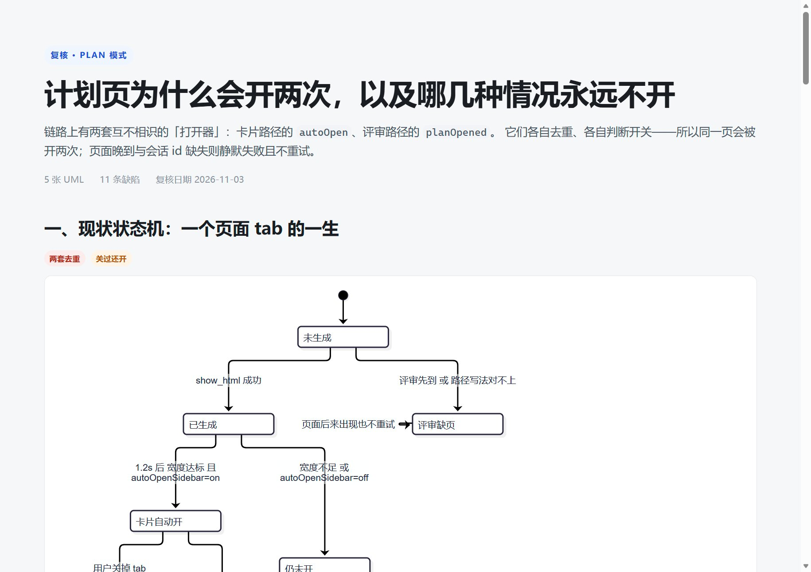
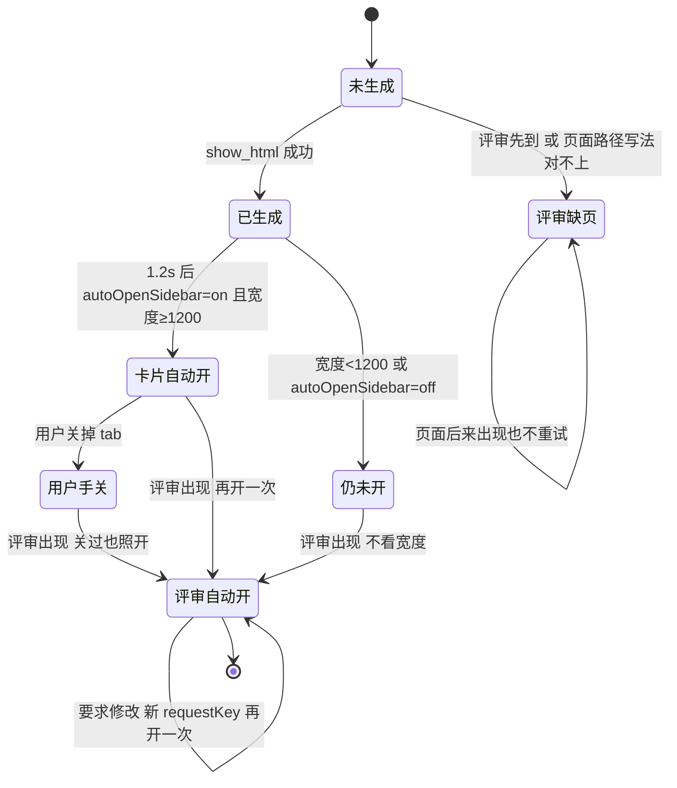
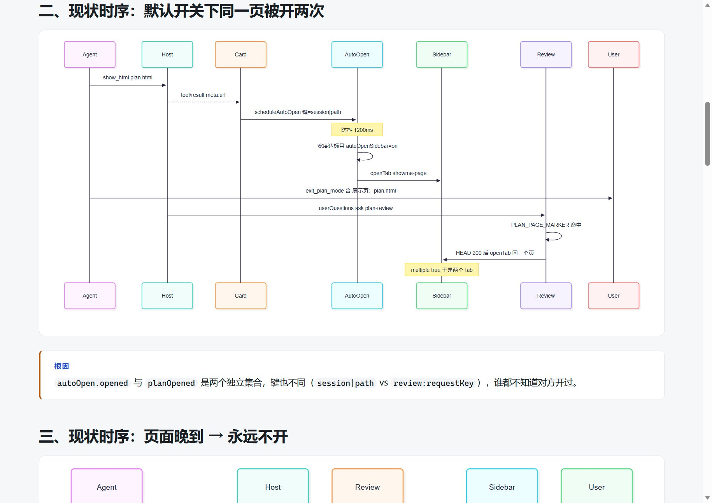
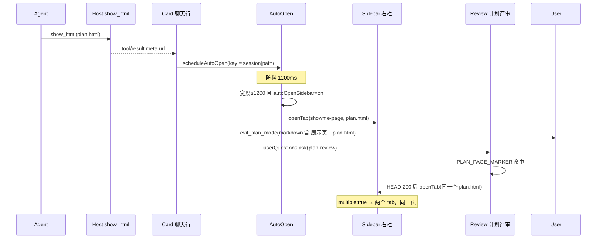
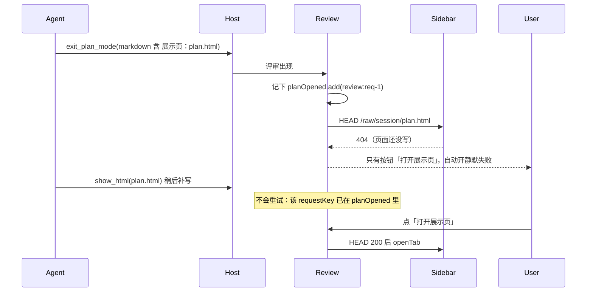
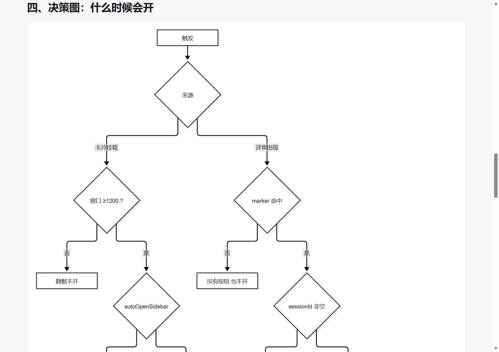
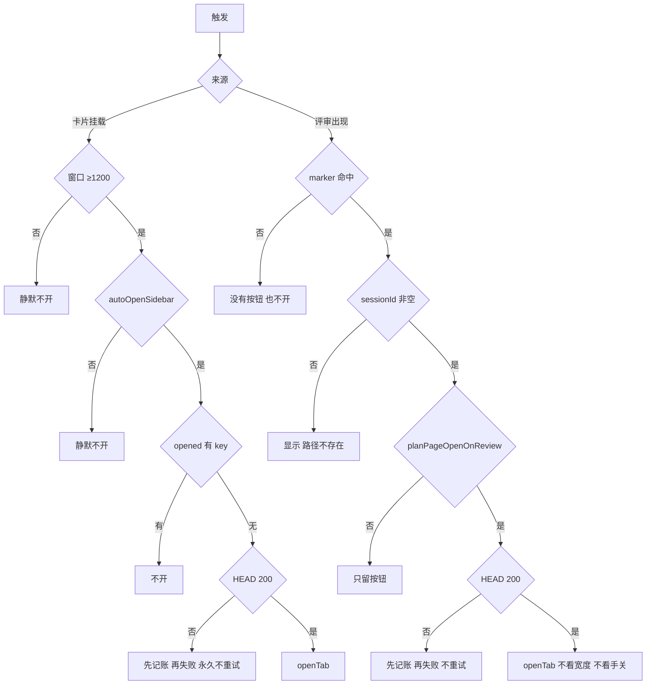

# plan 模式下的展示页：行为逻辑复核（UML）

> 复核对象：`showme:plan-page` 指引 → `show_html` → 卡片自动开右栏 → `exit_plan_mode` 评审 → 「打开展示页」/评审自动开。
> 结论先说：**同一条链路上有两套互不相识的"打开器"**（卡片路径的 `autoOpen`、评审路径的 `planOpened`），
> 它们各自去重、各自判断开关，于是同一页会被开两次；而"页面晚到""会话 id 缺失""路径写法不同"三种情况都会静默失败且不重试。

## 0. 参与者与代码位置

| 参与者 | 代码 | 职责 |
|---|---|---|
| `Host` | `lib/index.js:1550` `planPageGuide` | 往系统提示塞一段"计划要产页 + 写 `展示页：<路径>`" |
| `Agent` | — | 调 `show_html` 写页；调 `exit_plan_mode` 交计划 |
| `Card` | `lib/client.js:1002-1015` | 卡片挂载后 `scheduleAutoOpen`（每轮只开最后一张） |
| `AutoOpen` | `lib/client.js:516-543` | 防抖 1.2s；宽度闸；`autoOpenSidebar` 闸；`opened` 去重；HEAD 后 `openTab` |
| `Review` | `lib/client.js:1682-1720` `PlanPageAction` | 解析 `展示页：`；`planPageOpenOnReview` 时自动开；给按钮 |
| `Sidebar` | `lib/client.js:283-291` | 页类型 `multiple: true`（**允许同页多 tab**） |
| `Prefs` | `lib/index.js:86` / `lib/client.js:460` | 三个开关，用户级落盘 |

> 渲染后的页面：`.dsh/showme/plan-mode-uml.html`（5 张 mermaid 图 + 缺陷表）；下面三张是它的截图。

## 1. 现状状态机（页面 tab 的生命周期）

三个状态转移看着"都能用"，但合起来是：**同一页最多会被开 3 次**（卡片、评审、要求修改后再评审），而"该开一次却没开"的两种路径都**不会自愈**。

## 2. 现状时序：默认开关下，同一个计划页被开两次

**根因**：`autoOpen.opened`（`lib/client.js:541`）与 `planOpened`（`:546`）是两个独立集合，键也不同
（`session|path` vs `review:requestKey`），谁都不知道对方开过。

## 3. 现状时序：页面晚到 → 永远不开，且提示是错的

**根因**：`planOpened.add(key)` 写在**尝试打开之前**（`:1703`），HEAD 404 也当成"开过了"。
顺序假设（先写页、后评审）在提示词里没有强制，模型完全可能反过来。

## 4. 现状决策图：什么时候会开

注意两条分支的**闸门集合不一样**：卡片路径看宽度与 `autoOpenSidebar`，评审路径两个都不看。

## 5. 缺陷清单（触发 / 现象 / 根因）

| # | 触发 | 现象 | 根因（代码位置） | 级别 |
|---|---|---|---|---|
| **D1** | 默认开关 + 一次正常计划回合 | 同一页在右栏**两个 tab** | 两套去重集合互不知情（`client.js:541`、`:546`） | P0 |
| **D2** | 用户手动关掉自动开的 tab，之后评审出现 | 又开回来，"手动关掉后不再抢"失效 | 评审路径只查 `planOpened`，不查"用户关过"（`:1699-1707`） | P0 |
| **D3** | 窗口 <1200px | 卡片路径不开（对），评审路径仍开（错） | `AUTO_OPEN_MIN_WIDTH` 只用在 `runAutoOpen`（`:537`） | P1 |
| **D4** | 宿主没把 `sessionId` 传给 action 槽（或晚到） | 按钮显示「路径不存在」，自动开不生效——明明路径没问题 | `PlanPageAction` 只用 `props.sessionId`（`:1686`），没有卡片那三级兜底 `resolveSessionId`（`:831`） | P0 |
| **D5** | 先 `exit_plan_mode` 后写页（或页面后补） | 自动开失败且**永不重试** | 记账在尝试之前（`:1703`、`:541`） | P0 |
| **D6** | 标记写法变体：反引号包裹、`- 展示页：…`、`./` 前缀、反斜杠、行尾带说明、全角括号 | 按钮不出现 / HEAD 404 → 静默 | 正则 `/^\s*展示页[:：]\s*(\S+)\s*$/m`（`:451`）要求整行恰好一条；`rawUrl` 只做去前导斜杠与反斜杠归一（`:359`） | P1 |
| **D7** | 计划里在正文举例子写到"展示页：xxx" | 打开一个并非交付物的页面 | 宿主指引说"**第一段**"（`index.js:1557`），客户端扫**全文** | P1 |
| **D8** | 自动开失败（宽度/偏好/HEAD/openTab 抛错） | 什么都不说 | 全程静默，没有徽标/提示 | P2 |
| **D9** | `planPage=require` | 计划还没评审，页面就已在右栏弹出 | `show_html` 仍走卡片自动开（`:1002-1015`），与"评审时开"语义重叠 | P2 |
| **D10** | 评审点「要求修改」→ 再评审 | 同一页再开一个 tab | `requestKey` 变了，`planOpened` 认不出这是同一页 | P1 |
| **D11** | 页面路径写成绝对路径或指向别的工作区 | HEAD 404 或开到无关页 | 没有"路径必须工作区相对"的规范化与提示 | P2 |

> 说明：D1/D5/D10 是**逻辑层可证**（集合与顺序），D4 取决于宿主是否给 `sessionId`（本机 0.1.7-rc.2 给了，所以之前真机没暴露）。
> 还没做的一件事实：**D1 的真机复现**——上次真机验证时我把 `autoOpenSidebar` 关掉了，正好绕过了它。

## 6. 目标态（建议）：一个 opener，一个去重键

```mermaid
sequenceDiagram
    participant A as Agent
    participant H as Host
    participant C as Card
    participant R as Review
    participant P as PlanPageOpener 唯一打开器
    participant S as Sidebar

    A->>H: show_html(plan.html)
    H-->>C: meta.url
    C->>P: want(session, path, 来源=card)
    A->>H: exit_plan_mode(markdown)
    H->>R: 评审出现
    R->>P: want(session, path, 来源=review)
    P->>P: 归一路径 + 键 = session|path
    alt 同一页已开
        P-->>R: 已开过（按钮变「已在右栏」）
    else 未开且闸门允许
        P->>P: 宽度 ≥1200 或 来源=review 且用户点了按钮
        P->>S: HEAD 200 才 openTab
        P->>P: 成功后才记账
    else HEAD 404
        P->>P: 记账为 pending，1s×10 重试
    end
```

要点（按优先级）：

1. **合并去重**：一个 `Map<session|path, 'opened'|'pending'|'closedByUser'>`，卡片与评审共用；键用**归一化后的工作区相对路径**。
2. **只记成功**：`openTab` 返回成功才记 `opened`；HEAD 404 记 `pending` 并重试（10 次 × 1s，页面常见于评审前后 1–2 秒内落盘）。
3. **sessionId 兜底**：`PlanPageAction` 复用 `resolveSessionId` 的三级兜底；仍拿不到就把按钮文案改成「会话还没就绪」，**不要**说"路径不存在"。
4. **闸门统一**：宽度闸对两条路径都生效；`autoOpenSidebar` 只管卡片路径，`planPageOpenOnReview` 只管评审路径（现在的语义保留），但"用户关过"对两条都生效。
5. **标记解析放宽**：允许行首 `- ` / `1. `、反引号包裹、行尾注释；宿主与客户端统一到"第一段里出现即算"（同时把指引措辞改准）。
6. **可见性**：自动开被跳过时，在评审按钮的 `title` 或卡片徽标里写一句原因（宽度 / 偏好 / 页面不存在），别再静默。

## 7. 未验证 / 需要你确认

- **你实际遇到的症状是哪一条？** 上面的 D1（两个 tab）、D2（关了又开、很烦）、D4（按钮说"路径不存在"）在体验上完全不同，修法优先级也不同。
- D4 依赖宿主把 `sessionId` 传进 `conversation.plan-review.actions`；本机 0.1.7-rc.2 传了（真机开得出来），别的版本没测。
- D1 的真机复现（默认开关跑一个 `/plan` 回合数 tab）还没做，需要一次模型回合，约 5–8 分钟。
